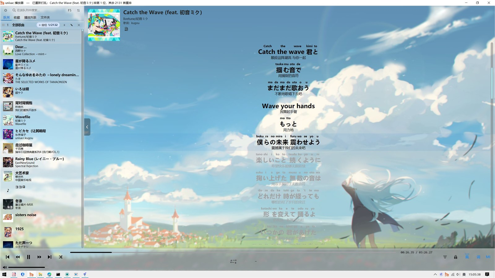
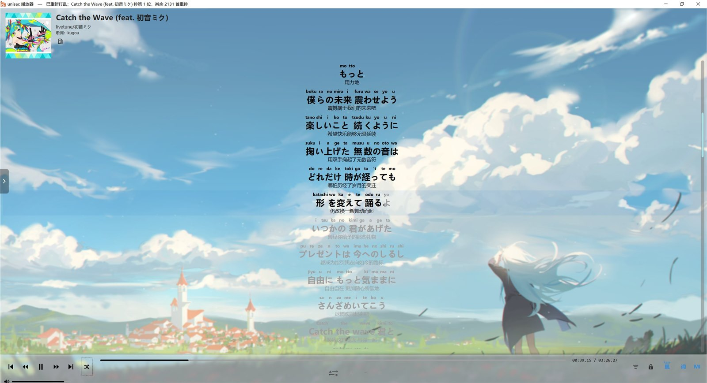
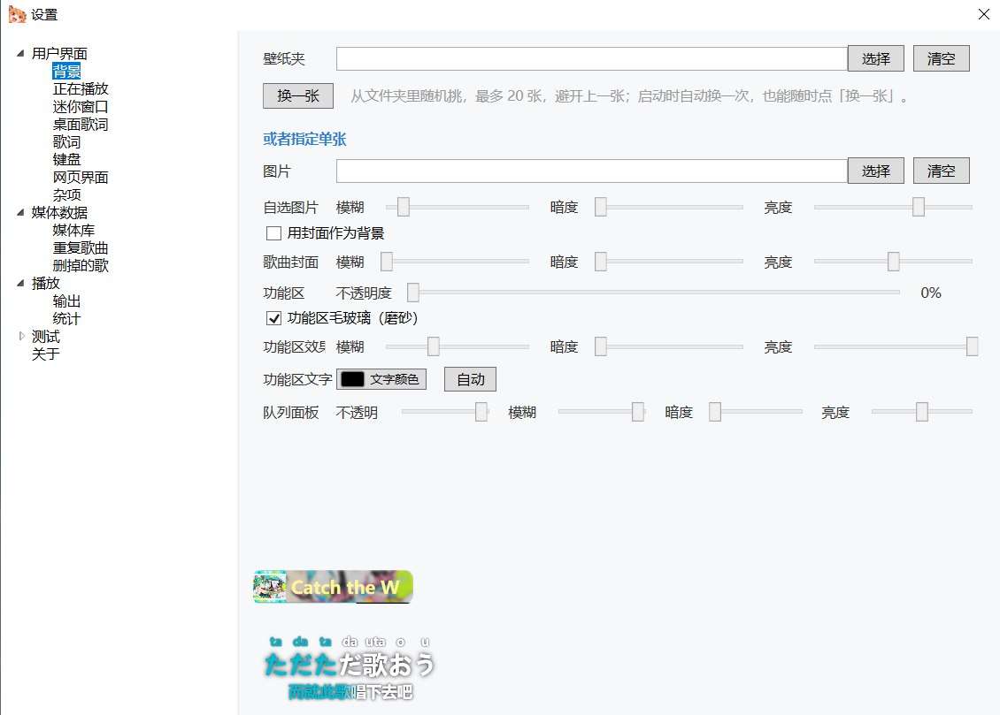

[README-GitHub.md](https://github.com/user-attachments/files/34212107/README-GitHub.md)
# unisac 音乐播放器

> 本地曲库播放器。单文件 exe，解压双击就能用。

---

## 下载

**[→ 点这里下载最新版](https://github.com/unisacr/unisacr/releases/latest)**

⚠ **压缩包有解压密码：u114514QvQ!CR**

解压后双击 `UniSac.exe`。

---

## 它长什么样





### 桌面歌词

可以拆成**上下两个独立小窗**，各自拖到任意位置：


### 设置

壁纸、功能区透明度、队列面板、滚动条，都在「背景」这一页调：



---

## 它能干什么

### 曲库
- 扫 **mp3 / flac / m4a / wav / ape**，按文件夹递归，几千首一两分钟
- 按歌名 / 歌手 / 专辑搜索，按歌名 / 歌手 / 专辑 / 时长 / 添加时间排序
- 排除某个文件夹，或者单独排除某个文件（不动磁盘上的文件）
- **重复歌曲检测**：按指纹分组，按音质排序（无损 > 有损，再比位深 / 采样率 / 码率），告诉你该留哪份
- **删歌有记录**：什么时候删的、为什么删、在哪删的，能导出清单以后找回

### 歌词
- 四个源：**酷狗 / 网易云 / QQ / 酷我**，自动挑最合适的那份
- 支持**逐字时间**（酷狗的 KRC、网易云的 YRC 都认），不是一句一句跳
- 三种显示：**原文 / 罗马音 / 翻译**（日语歌注音靠内置 IpaDic 词典）
- 对不上可以手动搜、手动调整体偏移（每首歌单独记住）
- 抓过的歌词缓存在本地，第二次打开秒出

### 播放
- WASAPI 共享模式，**24bit** 输出
- FLAC 用自研解码器，不依赖系统解码器，什么 flac 都能放
- **响度归一化**：不同专辑、不同年代的音量自动拉齐（目标 -16 / -14 / -12 LUFS 可选）
- 播放模式：顺序 / 随机 / 单曲循环 / 列表循环

### 桌面歌词
- 可以拆成**上下两个独立小窗**（第一句在上、第二句在下），各自拖到任意位置
- 锁定 / 解锁、字体字号颜色、背景条浓度都能调
- 跟着播放位置**逐字高亮**

### 迷你小窗
- 默认 190×70，可拖位置、可缩放
- 平时只显示封面和歌名，**鼠标移上去**才出上一首 / 播放 / 下一首
- 进度条能点能拖，颜色可调

### 界面
- **壁纸**：整窗铺一张图，也可以指定一个文件夹**随机轮换**（每次启动换一张）
- **主题**：最多存 3 套界面配色，一键切换
- 功能区 / 队列面板 / 滚动条的颜色、透明度、模糊各自可调

### 其它
- 收藏、播放列表（可拖动排序）、播放统计（按周 / 月 / 全部）

---

## 激活（免费）

**完全免费。** 要激活码直接找我要（QQ **3495216356**，加好友请备注「激活码」）。

1. 打开程序 →「设置」→ 左侧「关于」
2. 点「复制机器码」，得到形如 `1GP3-HFMR-7897-3471` 的一串
3. 加我 QQ 发过来（或者在仓库开 issue）
4. 我把激活码发回来
5. 「关于」→「激活…」→ 粘贴 → 确定

- 一个码认一台电脑
- 换电脑、重装系统后机器码会变，把新的发我，**免费换**

---

## 系统要求

- Windows 10 / 11（64 位）
- **不需要**安装 .NET（自包含单文件）
- 解压后是这些：

```
UniSac.exe        主程序
IpaDic\           日语词典，罗马音注音靠它
壁纸\             默认背景图（不想要整个删掉）
使用说明.txt
```

---

## 说明

- 程序**只读**你的音乐文件，不改、不删、不移动
- 歌词来自公开接口，仅供个人学习与欣赏使用
- **请支持正版音乐**
- 本项目仅供个人使用，请勿用于商业用途

---

## 常见问题

**Q：我下的歌是 .kgm / .ncm 格式，播不了**

A：那是加密格式，需要先转成普通格式（flac / mp3）。

---

## 关于这个仓库

这里只放**说明和发布包**（Releases），源码不公开。

有问题、想提功能，直接开 issue，或者加 QQ 问都行。

会持续更新——这玩意是作者做来自己用的，顺手就发了。
